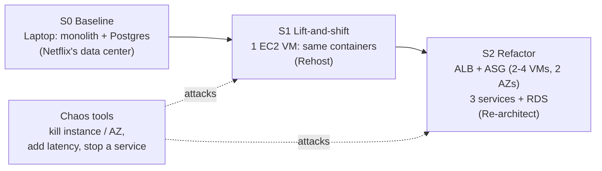
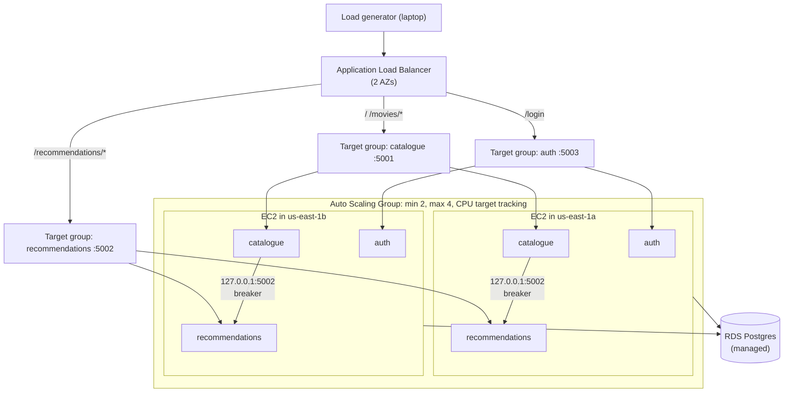
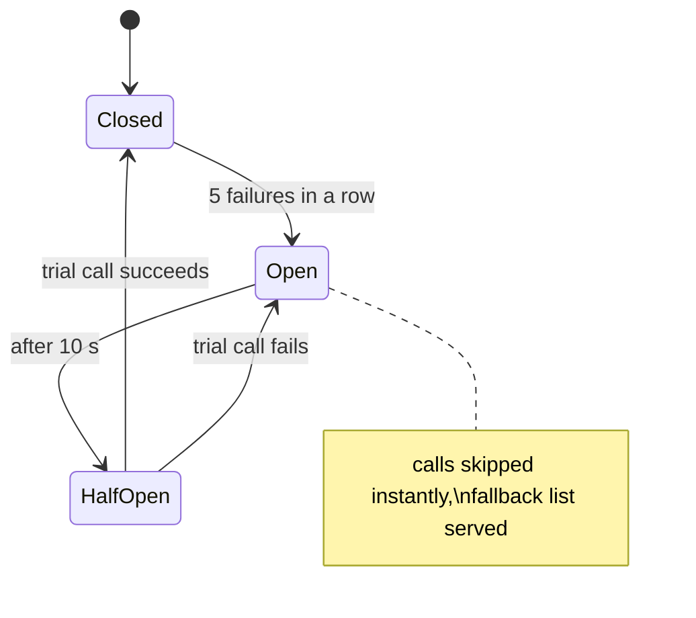

# Mini-Netflix: Complete Project Guide (End to End)

**IT457 Cloud Computing, Case Study Project, Group 16**
**Topic:** Netflix's migration to AWS and chaos engineering
**Project:** *"Mini-Netflix: migrate it, then break it on purpose"*

This file explains the whole project from start to finish: the Netflix story, what we built, how every part of the code works, which experiments we ran, what the results were, and what they mean. If you can explain everything in this file, you can answer any viva question.

> **The one-sentence claim of the project:**
> *Moving to the cloud is not enough. The architecture is what makes a system survive failure, and the only way to prove it is to break it on purpose.*

---

## Table of contents

1. [The 30-second pitch](#1-the-30-second-pitch)
2. [The Netflix case study](#2-the-netflix-case-study)
3. [What we built: the four stages](#3-what-we-built-the-four-stages)
4. [Repository map](#4-repository-map)
5. [The application, file by file](#5-the-application-file-by-file)
6. [Containers and local stacks](#6-containers-and-local-stacks)
7. [AWS infrastructure (Terraform)](#7-aws-infrastructure-terraform)
8. [Chaos engineering tools](#8-chaos-engineering-tools)
9. [Load generator and analysis](#9-load-generator-and-analysis)
10. [Experiments and hypotheses](#10-experiments-and-hypotheses)
11. [Results](#11-results)
12. [Cost model](#12-cost-model)
13. [Limitations](#13-limitations)
14. [How to run everything](#14-how-to-run-everything)
15. [The live demo](#15-the-live-demo)
16. [Viva questions with model answers](#16-viva-questions-with-model-answers)
17. [Glossary](#17-glossary)
18. [Key numbers to remember](#18-key-numbers-to-remember)

---

## 1. The 30-second pitch

In 2008 Netflix's single database got corrupted and the company could not ship DVDs for three days. Netflix moved to AWS and, more importantly, **rebuilt** its system so that no single part could take everything down. Then it built **Chaos Monkey** to kill its own servers on purpose and prove the design worked.

We reproduced that journey in miniature:

- **S0:** a small movie-catalogue app (a monolith) running in Docker on a laptop. This is "Netflix's own data center".
- **S1:** the same app moved unchanged onto **one AWS server** (lift-and-shift).
- **S2:** the app split into **three services**, running on **2–4 servers across 2 data centers** behind a **load balancer**, with an **Auto Scaling Group** and a **managed database (RDS)**. This is "Netflix after the migration".
- Then we wrote our own **mini Chaos Monkey** and killed servers, a whole Availability Zone and a service, while a load generator measured every request.

**Result:** when its server was killed, S1 had **37.5%** availability and a **9-minute outage**. S2 lost three servers in ten minutes, and later a whole AZ, and stayed at **98.9–99.5%**, with no gap longer than **5 seconds**. Inside the app, a **circuit breaker** kept the home page at **100%** when the recommendations service died. Without it, availability fell to **59.6%**.

---

## 2. The Netflix case study

### 2.1 The problem (2008)

| Fact | Detail |
|---|---|
| What happened | August 2008: a major database corruption. Netflix could not ship DVDs for **3 days**. |
| Root cause | **Single points of failure**: one data center, one monolithic application, one vertically scaled relational (Oracle) database. |
| Why it mattered | Netflix was moving to streaming (launched January 2007). DVD-by-mail tolerates outages; streaming does not. |
| Other pain | Hardware had to be ordered months ahead for an unpredictable demand curve. Running data centers was "undifferentiated heavy lifting": it didn't make the product better. |

**Problem statement:** Netflix needed infrastructure that could grow quickly and unpredictably, with no single component able to stop the service, without spending engineers on running data centers.

### 2.2 Options Netflix had

| Option | Why it wasn't enough |
|---|---|
| Build a second data center | Reduces site risk, but keeps capital cost, slow capacity planning and the monolith. |
| Lift-and-shift to the cloud | Solves capacity, but every software single point of failure moves with it. **Our S1 proves this.** |
| **Move to AWS *and* rebuild cloud-native** (what Netflix did) | Removes the single points of failure. Took 7 years. **Our S2 reproduces this.** |

### 2.3 The migration journey

| Date | Event |
|---|---|
| Jan 2007 | Streaming launched |
| Aug 2008 | Database corruption, 3 days down; the cloud journey begins |
| 2009–2010 | Non-customer-facing, then customer-facing systems move to AWS |
| Dec 2010 | Blog: "Four Reasons We Choose Amazon's Cloud" and "5 Lessons We've Learned Using AWS" |
| Jul 2011 | Blog: "The Netflix Simian Army" (Chaos Monkey, Chaos Gorilla, Latency Monkey…) |
| 2012 | Open Connect (own CDN) announced; Chaos Monkey open-sourced (30 July 2012) |
| 24 Dec 2012 | AWS ELB failure in us-east-1 disrupts Netflix streaming in the Americas for ~20 hours, a key motive for multi-region active-active |
| 2013–2015 | Multi-region active-active; Chaos Kong regional evacuation drills |
| 20 Sep 2015 | DynamoDB disruption in us-east-1 hits many AWS customers; Netflix reports no significant impact |
| Jan 2016 | Last data center pieces (billing) shut down; migration complete; launch in 130 new countries |
| 2016–2017 | ChAP automates chaos experiments on small slices of real traffic |
| 2018 | Hystrix goes into maintenance mode; Netflix points to adaptive concurrency limits and resilience4j |

**Why 7 years?** Netflix chose to **refactor/re-architect**, not **rehost**. It rebuilt almost everything as hundreds of microservices. Data had to move from a relational database to distributed stores (Cassandra) with different consistency rules. Most tooling (service discovery, deployment, monitoring) didn't exist yet and had to be built. All of this happened while the service kept running for a fast-growing customer base. Risky parts (billing, customer data) moved last.

### 2.4 Architecture before and after

| Layer | Before (data center) | After (AWS) | Failure it removes |
|---|---|---|---|
| Hosting | One owned data center | Several AWS regions, each with multiple Availability Zones | Loss of a site, an AZ or a region |
| Application | Monolith, one deployment | Hundreds of microservices, deployed independently | A bug in one feature taking down the whole site |
| Compute | Fixed fleet of physical servers | EC2 instances in Auto Scaling Groups | Running out of capacity; manual server replacement |
| Traffic entry | Hardware load balancers | DNS → Elastic Load Balancing → Zuul gateway | Overloaded or failed entry point |
| Service-to-service calls | In-process function calls | Network calls via **Eureka** (discovery), **Ribbon** (client load balancing), **Hystrix** (timeout + circuit breaker + fallback) | One slow dependency causing a cascading failure |
| Data | One relational DB, scaled vertically | **Cassandra** (replicated across AZs/regions), EVCache, S3, DynamoDB | Loss of a database host |
| Video delivery | Third-party CDNs | **Open Connect**: Netflix's own CDN appliances inside ISP networks | High transit cost |
| Delivery and ops | Coordinated releases | Continuous delivery (Asgard → Spinnaker), "you build it, you run it" | Slow, risky releases |

**Design principles:**
1. **Assume everything fails.** Instances, AZs and even regions are disposable.
2. **Stateless services; state lives in replicated stores.** Any instance can be killed.
3. **Scale out, not up.** Many small instances, added automatically.
4. **Isolate failures.** Circuit breakers plus fallbacks give **graceful degradation**: if recommendations fail, show a generic popular list, not an error page.
5. **Trade consistency for availability where it's safe.** Cassandra follows the Dynamo design (eventual consistency); billing is treated more strictly.

**The price:** much more operational complexity. Microservices pay off at Netflix's scale; a small team may do better with a modular monolith on managed services.

### 2.5 Chaos engineering

**Idea:** fallback code paths are rarely used, so they break silently. Netflix causes failures **deliberately, in production, during working hours**, so a weakness shows up as a small controlled incident instead of a big one at 3 a.m. In its first open-source year, Chaos Monkey terminated over 65,000 instances.

| Tool | What it breaks | What it proves |
|---|---|---|
| **Chaos Monkey** | Kills random instances in an ASG | Services survive losing any one instance |
| **Latency Monkey** | Adds artificial delay to calls | Timeouts and fallbacks work; "slow" is handled like "down" |
| **Conformity / Janitor / Doctor Monkey** | Nothing; finds rule-breaking, unused or unhealthy resources | The fleet stays clean |
| **Chaos Gorilla** | A whole Availability Zone | Services are spread across AZs |
| **Chaos Kong** | A whole AWS region | Traffic can move to other regions |
| **FIT** (Failure Injection Testing) | Errors or latency in chosen requests only | Failure can be aimed at a few users |
| **ChAP** (Chaos Automation Platform) | Small slice of real traffic, control vs experiment group | Weaknesses found statistically, with automatic stop |

**The progression:** start crude (kill a machine), widen the blast radius (AZ → region) as confidence grows, then narrow it again with precise automated experiments (FIT, ChAP) so chaos can run continuously.

**Principles of chaos engineering** (principlesofchaos.org), which every one of our experiments follows:
1. **Define steady state.** This is a measurable customer-facing output. Netflix uses stream starts per second; ours is the % of home-page requests returning HTTP 200 within 1 s.
2. **Hypothesise** that steady state continues during the failure.
3. **Introduce real-world events:** crashes, latency, traffic spikes.
4. **Try to disprove the hypothesis.**
5. **Minimise the blast radius.** Stop automatically if customers are hurt.

**Evidence it worked:** the same kind of us-east-1 failure caused a ~20-hour outage in 2012 (before regional drills) and no significant impact in 2015 (after). Netflix did not publicly credit one specific tool.

**Today:** most of the Simian Army is retired, and Hystrix is in maintenance mode. The ideas survive in managed services such as **AWS Fault Injection Service (FIS)**. That's why our project includes both a hand-written Chaos Monkey (the original idea) and FIS templates (the modern managed version).

### 2.6 Outcomes and cost

- **Availability** improved toward Netflix's "four nines" (99.99%) goal.
- **Growth:** 8× more streaming members by 2016 than 2008; viewing grew by three orders of magnitude.
- **Global expansion:** 130 new countries in January 2016, using existing AWS regions.
- **Cost:** Netflix says cloud cost per streaming start ended up "a fraction" of the data center cost, but **cost was a side benefit, not the reason**. Exact figures are not public.
- **Not everything moved:** video bytes go through **Open Connect**, Netflix's own CDN, because owning is cheaper for huge, steady traffic. Netflix is **hybrid**: cloud for the brain, owned hardware for the bytes.

### 2.7 Lessons

1. Rehosting moves the problem; refactoring removes it.
2. Design for failure, then prove it. Untested redundancy should be assumed broken.
3. Measure customer-facing steady state, not CPU.
4. Widen the blast radius gradually: instance → AZ → region.
5. Migrate the least risky parts first.
6. Microservices are not free.
7. The cloud is not automatically cheaper. Choose per workload.

---

## 3. What we built: the four stages



| Stage | What it is | Netflix parallel | "6 Rs" term | Where it ran |
|---|---|---|---|---|
| **S0** | Monolith + Postgres in Docker Compose on a laptop | Pre-2009 data center | — | Laptop |
| **local-S2** | The S2 three-service split in Docker Compose, with nginx in place of the ALB; breaker on/off | Microservices + Hystrix | Refactor | Laptop |
| **S1** | The *unchanged* monolith + Postgres containers on **one** EC2 t3.micro in **one** AZ | Early cloud, rehosted | **Rehost** | AWS us-east-1 |
| **S2** | Three services on every instance; ALB path routing; ASG min 2 / max 4 across 2 AZs; CPU target tracking; RDS Postgres | Netflix after migration | **Refactor / re-architect** | AWS us-east-1 |
| **S3/S4** | Chaos tools and comparison of S1 vs S2 under the same failures | Chaos Monkey, Gorilla, Latency Monkey | — | Both |
| **S5** | Cost model: AWS vs GCP vs on-prem, plus own CDN vs CloudFront | Elasticity vs ownership; Open Connect | — | Script |

(Moving only the database to RDS, without splitting the app, would be **replatform**.)

### S1 architecture

```
Laptop load generator  --->  [ EC2 t3.micro, us-east-1a, public IP ]
                               ├── app container (monolith, port 80→5000)
                               └── db container (Postgres)
```
One VM, one AZ, one public IP, database on the same machine. If the VM dies, everything dies.

### S2 architecture



Every instance runs all three service containers. Instances are **stateless** because the data lives in RDS, so any instance can be killed and replaced.

---

## 4. Repository map

```
Project/
├── README.md                 original plan, idea comparison, timeline
├── README-EXPLAINED.md       plain-English introduction
├── PROJECT-README.md         this file
├── requirements-tools.txt    Python deps for tools on your machine (boto3, pandas, matplotlib, pytest…)
│
├── app/                      THE APPLICATION
│   ├── src/
│   │   ├── main.py           app factory; SERVICE env var picks which endpoints to serve; /health
│   │   ├── catalogue.py      /, /movies, /movies/<id>; the circuit breaker + fallback
│   │   ├── recommendations.py /recommendations/<user>; fault injection (/admin/fault)
│   │   ├── auth.py           /login; HMAC-signed token
│   │   └── db.py             Postgres/SQLite layer, connection pool, seeding
│   ├── tests/test_app.py     pytest: endpoints, idempotent seed, breaker on/off, faults
│   ├── Dockerfile            python:3.12-slim + gunicorn
│   ├── docker-compose.yml    S0: monolith + Postgres  → localhost:8080
│   ├── docker-compose.services.yml  local-S2: 3 services + Postgres + nginx  → localhost:8081
│   ├── nginx.conf            local stand-in for the ALB's path routing
│   └── requirements.txt      flask, gunicorn, psycopg2, pybreaker, requests
│
├── infra/                    AWS, ALL IN TERRAFORM
│   ├── shared/main.tf        ECR registry, $5 budget alert, EC2 IAM instance profile
│   ├── s1/main.tf, user_data.sh   one EC2 instance
│   ├── s2/main.tf, variables.tf, outputs.tf, user_data.sh   ALB + ASG + RDS
│   ├── s2/fis.tf             optional AWS Fault Injection Service templates
│   ├── build_push.sh         build the Docker image and push to ECR
│   └── README.md             step-by-step AWS guide
│
├── chaos/                    CHAOS ENGINEERING
│   ├── chaos_monkey.py       terminate/stop random tagged EC2 instances, or a whole AZ
│   ├── fault.py              latency injection / stop the recommendations service (local or via SSM)
│   ├── watch.py              poll ASG, target-group health, EC2 count every 2 s
│   ├── run_experiment.py     orchestrator: watcher + load + chaos + analysis in one command
│   └── test_chaos_monkey.py  offline tests of the safety rails (fake EC2)
│
├── loadtest/                 MEASUREMENT
│   ├── loadgen.py            closed-loop load generator, logs every request to CSV
│   ├── analyze.py            one run → summary.json + timeline.png
│   ├── compare.py            all runs → summary_table.md + comparison charts
│   └── run_local_suite.sh    runs every local experiment (~1 hour)
│
├── cost/                     S5 COST MODEL
│   ├── cost_model.py         → cost_table.md + results/charts/cost_breakeven.png
│   └── cost_table.md
│
├── results/                  EVIDENCE
│   ├── <stage>/<exp>/run<N>/ requests.csv, events.csv, watch.csv, summary.json, timeline.png
│   ├── aws-logs/             Terraform apply/destroy logs, AWS ASG activity history, CPU, clean-up checks
│   ├── charts/               comparison charts
│   └── summary_table.md      the master results table
│
├── demo/                     VIVA DEMO
│   ├── tour.py, tour.html    the full project tour (all chapters, live + replays) → localhost:8095
│   ├── demo.sh               terminal demo of the circuit breaker (5 steps)
│   ├── dashboard.py          same demo in a browser (localhost:8090)
│   └── dashboard.html
│
└── docs/                     REPORTS
    ├── week1-summary.md/.pdf, week2-report.md/.pdf, week3-runbook.md
    ├── final-report.md/.pdf  the full report
    ├── week5-viva-prep.md    talk plan and Q&A
    ├── presentation.pptx     slides (built by build_deck.py)
    └── diagrams/             before/after and stage diagrams (SVG + PNG)
```

---

## 5. The application, file by file

The app is a **movie catalogue**: 1,000 seeded movies in 10 genres and 100 users (`user1`…`user100`, password `password`). It's deliberately simple. The project is about *where and how it runs*, not about the app.

**Tech stack:** Python 3.12, Flask 3.1 (web framework), Gunicorn (production server: 2 workers × 4 threads), Postgres 16 (SQLite for tests), `pybreaker` (circuit breaker), `requests` (HTTP client), Docker.

### 5.1 Endpoints

| Endpoint | Service | What it does |
|---|---|---|
| `GET /health` | all | Pings the database; 200 `ok` or 503 `db-error`. Used by the ALB health check. |
| `GET /` | catalogue | **Home page = the steady-state request.** Top-10 trending movies + 10 personal recommendations. |
| `GET /movies?page=&genre=` | catalogue | 20 movies per page, optional genre filter |
| `GET /movies/<id>` | catalogue | One movie, or 404 |
| `GET /recommendations/<user>` | recommendations | Top-10 movies in the user's "favourite genre" |
| `POST /login` | auth | Checks username/password, returns a signed token |
| `POST/DELETE/GET /admin/fault` | recommendations | Fault injection; exists only when `FAULTS_ENABLED=1` |

Every response gets an **`X-Served-By: <instance-id>/<service>`** header, and the home page an **`X-Recs-Source: personal|fallback`** header. The load generator records both, so we can prove *which EC2 instance* answered each request and *whether the fallback was used*.

### 5.2 `main.py`: one codebase, four roles

`create_app()` reads the **`SERVICE`** environment variable and registers Flask **blueprints** accordingly:

| `SERVICE` | Blueprints | Used in |
|---|---|---|
| `monolith` | catalogue + recommendations + auth | S0, S1 |
| `catalogue` | catalogue | S2 |
| `recommendations` | recommendations | S2 |
| `auth` | auth | S2 |

**Why this matters for the viva:** S0, S1 and S2 all run the **same Docker image**. The only difference is configuration, so any difference in results comes from the **architecture**, not from different code. This is what makes the comparison fair.

It also defines `/health` (with a database ping) and an `after_request` hook that adds `X-Served-By`. The instance ID comes from `INSTANCE_ID` (read from EC2 instance metadata at boot) or the container hostname.

### 5.3 `catalogue.py`: the circuit breaker (the most important code)

The home page needs recommendations. *How* it gets them depends on the stage:

```
SERVICE=monolith         → recommendations.compute(user)   in-process function call
SERVICE=catalogue, BREAKER=on  → HTTP call, 250 ms timeout, pybreaker, fallback
SERVICE=catalogue, BREAKER=off → HTTP call, 5 s timeout, no breaker, error → 502
```

**With `BREAKER=on` (the Hystrix pattern):**
1. The call to `http://127.0.0.1:5002/recommendations/<user>` has a **250 ms timeout**.
2. It goes through a `pybreaker.CircuitBreaker(fail_max=5, reset_timeout=10)`.
3. **Closed** (normal): calls go through. After **5 consecutive failures** the breaker **opens**.
4. **Open:** for **10 s** no calls are made at all. The function fails instantly, so no threads are tied up waiting.
5. **Half-open:** after 10 s, one trial call is allowed. If it succeeds, the breaker closes; if not, it opens again.
6. On *any* failure, the home page returns `recommendations.popular()` (a generic top-10 list) with `X-Recs-Source: fallback`. **The user still gets HTTP 200.** This is graceful degradation.



**With `BREAKER=off` (naive call):** a 5 s timeout and no fallback. Any `requests` exception becomes `RecommendationsUnavailable`, which an error handler turns into **HTTP 502**. One failed dependency breaks the whole home page: a **cascading failure**.

**Why a short timeout matters ("slow is worse than down"):** a slow dependency holds a worker thread for the whole wait. With only 2 workers × 4 threads, a few slow calls exhaust the server, and every user gets slow. The 250 ms timeout turns "slow" into "failed", which the breaker can handle.

The catalogue reuses one `requests.Session` (HTTP keep-alive) for efficiency.

### 5.4 `recommendations.py`: recommendations and fault injection

- `favourite_genre(user)` = `GENRES[crc32(user) % 10]`. This is a **deterministic** "taste profile", so results repeat exactly between runs.
- `compute(user)` returns the top 10 movies in that genre by rating. `popular()` returns the overall top 10 (the fallback).
- **Fault injection (experiment E3):** when `FAULTS_ENABLED=1`, `POST /admin/fault {"latency_ms":300}` or `{"error_rate":1}` writes the setting to a **file** (`/tmp/minix_fault.json`). Every request reads it, sleeps `latency_ms`, or returns 500 with probability `error_rate`. `DELETE` clears it.
  - *Why a file and not a Python variable?* Gunicorn runs several worker **processes**. A global variable would change only in the one worker that handled the POST; a file is seen by all of them.
  - The endpoint returns **404 unless explicitly enabled**, so it cannot be abused in a normal deployment.

### 5.5 `auth.py`: login

Looks up `password_hash` for the username, compares with `hmac.compare_digest` (a **constant-time** comparison that avoids timing attacks), and returns a token `username:expiry:HMAC-SHA256 signature` valid for 1 hour, signed with `TOKEN_SECRET`. On AWS, Terraform generates a random 32-character secret. Password hashing is a toy SHA-256 (fine for fake demo users; a real system would use bcrypt/argon2, and the code comment says so).

### 5.6 `db.py`: database layer

- One `DATABASE_URL` switches between **Postgres** (`postgresql://…`) and **SQLite** (`sqlite:///…`, used in tests). Queries use `%s` placeholders, converted to `?` for SQLite.
- **Connection pool:** `psycopg2` `ThreadedConnectionPool` (max 8), created lazily with double-checked locking so threads don't create two pools.
- **Self-healing connections:** if a query fails, the connection is **closed and dropped** instead of being returned to the pool. After an RDS restart or failover, broken connections don't keep poisoning later requests.
- **Seeding:** 1,000 movies and 100 users generated with a fixed random seed (`Random(42)`), so every stage has identical data. Tables are created with `IF NOT EXISTS`, rows inserted with `ON CONFLICT DO NOTHING`, so seeding is **idempotent**.
- **`pg_advisory_xact_lock(457)`:** in S2, several instances boot at the same moment and all try to seed RDS. A Postgres advisory lock makes them take turns, so there are no duplicate-key races.
- **`init()` retries 30 times every 2 s**, because the database container (or RDS) may not be ready yet when the app starts.
- An index on `(genre, rating)` speeds up the recommendations query.

### 5.7 Tests (`app/tests/test_app.py`, `chaos/test_chaos_monkey.py`)

Run with `pytest app/tests chaos`. Each app test builds the app against a temporary SQLite file and reloads modules, because settings are read at import time.

| Test | Proves |
|---|---|
| `test_monolith_endpoints` | All endpoints work; 404 for a missing movie; login 200/401; `X-Served-By` present |
| `test_seed_is_idempotent` | Seeding twice still gives exactly 1,000 movies |
| `test_breaker_on_falls_back_when_recs_down` | With recommendations unreachable (port 9), 8 home requests all return **200 + fallback** |
| `test_breaker_off_propagates_error` | Same situation without the breaker returns **502** |
| `test_fault_injection` | `error_rate=1` causes 500; clearing restores 200 |
| `test_fault_endpoint_hidden_by_default` | `/admin/fault` is 404 unless enabled |
| Chaos Monkey tests (fake EC2, no AWS) | Only tagged instances are targeted; refuses if >4 match; `--dry-run` touches nothing; `--az` kills only that AZ; `stop` action for S1 |

---

## 6. Containers and local stacks

### `Dockerfile`
`python:3.12-slim`, installs requirements, copies `src/`, then runs
`gunicorn --workers 2 --threads 4 --bind 0.0.0.0:$PORT --timeout 30 "src.main:create_app()"`.
One image serves every role; `SERVICE` and `PORT` are set at run time.

### `docker-compose.yml` (S0)
`db` (Postgres 16 with a `pg_isready` health check and a volume) + `app` (`SERVICE=monolith`, port **8080**). The app waits until the DB is healthy.

### `docker-compose.services.yml` (local-S2)
- `catalogue` (port 5001), `recommendations` (5002, faults enabled) and `auth` (5003) share **one network namespace** (`network_mode: service:catalogue`), so the catalogue calls recommendations on `127.0.0.1:5002`. **This copies exactly how they talk on an S2 EC2 instance**, where containers use `--network host`.
- `gateway`: nginx on port **8081** with `nginx.conf` doing the same path routing as the ALB (`/recommendations/` → 5002, `/login` → 5003, everything else → 5001).
- `BREAKER=${BREAKER:-on}` lets you start it with the breaker on or off.

---

## 7. AWS infrastructure (Terraform)

**Everything on AWS was created from code with Terraform and destroyed after the runs.** This makes it reproducible, reviewable and cheap. All resources are tagged `project=mini-netflix` and `stage=s1|s2` via `default_tags`. The chaos tools rely on those tags.

### 7.1 `infra/shared/` (created once)
- **ECR repository** `mini-netflix`: the private Docker registry the instances pull from.
- **AWS Budget** of **$5/month**, with emails at 80% actual and 100% forecast. Cost control came first.
- **IAM role + instance profile** with `AmazonSSMManagedInstanceCore` (lets `fault.py` run commands through **SSM**, with no SSH keys or open port 22) and `AmazonEC2ContainerRegistryReadOnly` (pull images). An `existing_instance_profile` variable supports AWS Academy's `LabInstanceProfile`.

`infra/build_push.sh` logs in to ECR, builds the image for `linux/amd64`, and pushes it.

### 7.2 `infra/s1/` (lift-and-shift)
- One **t3.micro** EC2 instance in **us-east-1a**, Amazon Linux 2023 (latest AMI looked up from an SSM public parameter), default VPC, public IP.
- Security group: only port 80, only from `allowed_cidr` (your IP/32).
- **IMDSv2 required** (`http_tokens = "required"`): a security best practice for instance metadata.
- `user_data.sh` installs Docker, logs in to ECR, reads the instance ID from metadata, and runs **the same two containers as S0** (Postgres + monolith) with `--restart unless-stopped`. Containers come back if the VM restarts, but **nothing replaces the VM if it dies**.
- `terraform apply` took **33 s**.

### 7.3 `infra/s2/` (refactor)

| Resource | Settings | Why |
|---|---|---|
| **Subnets** | Default VPC public subnets in us-east-1a and us-east-1b | No NAT gateway needed, so cost stays near zero |
| **Security groups** | ALB: port 80 from your IP. App: ports 5001–5003 **only from the ALB's SG**. DB: 5432 **only from the app SG** | Least-privilege layering; the DB is unreachable from the internet |
| **RDS Postgres 16** | db.t3.micro, 20 GB gp2, not public, random 24-char password, no backups, `skip_final_snapshot` | Managed database; instances become stateless. (Multi-AZ off to save cost; a variable can turn it on) |
| **ALB** | Listener on 80. Default → catalogue TG; `/recommendations/*` → recommendations TG; `/login` → auth TG | Path-based routing, which is what makes it "microservices" from the outside |
| **Target groups** | One per service; health check `/health` **on port 5001** every 10 s, 2 healthy / 2 unhealthy, timeout 5 s; deregistration delay 10 s | All groups judge an instance by the catalogue. Stopping only the recommendations container (E4) then tests the circuit breaker instead of making the ASG replace every instance |
| **Launch template** | t3.micro, AL2023, IMDSv2, **detailed monitoring** (1-minute CPU metrics so scaling reacts faster), user data with DB URL, token secret and breaker setting | Every new instance configures itself |
| **Auto Scaling Group** | **min 2, desired 2, max 4**, across both AZs; **`health_check_type = "ELB"`**; grace period 120 s; warm-up 60 s; attached to all 3 target groups | ELB health checks make the ASG replace instances whose *app* is unhealthy, not only dead VMs |
| **Scaling policy** | **Target tracking** on `ASGAverageCPUUtilization`, target **50%** (lowered to 30% for the heavy E5 run) | AWS adds or removes instances to keep average CPU near the target |

`s2/user_data.sh` pulls the image and starts **catalogue, recommendations and auth** on `--network host`, each with `INSTANCE_ID`, `DATABASE_URL` and `TOKEN_SECRET`. The catalogue gets `RECS_URL=http://127.0.0.1:5002` and `BREAKER=on|off`.

`outputs.tf` exposes the ALB URL, ASG name and catalogue target group name, which `run_experiment.py` and `watch.py` need.

`terraform apply` for S2 took **about 7.5 minutes**, mostly creating RDS. The first apply failed because the Auto Scaling **service-linked role** (created automatically on first use in a new account) wasn't usable yet 5 seconds after creation; re-running fixed it.

### 7.4 `infra/s2/fis.tf` (optional, `enable_fis = true`)
The **AWS Fault Injection Service** versions of our chaos experiments:
- `terminate_one`: terminate 1 random `stage=s2` instance (E1)
- `az_outage`: terminate all s2 instances in the first AZ (E2)
- `cpu_stress`: run `AWSFIS-Run-CPU-Stress` on all instances for 5 minutes (E5)
- All have a **stop condition**: a CloudWatch alarm on ALB 5xx > 500/minute aborts the experiment, which limits the blast radius.

They're written and ready, but **we didn't run them** (time). That's an honest limitation.

### 7.5 How an ASG recovers a killed instance (be ready to explain)
1. The chaos script calls `TerminateInstances`.
2. The ASG sees in-service capacity (1) below desired (2) and **immediately launches a replacement** from the launch template. We measured **within 2 s**.
3. Meanwhile the **ALB** marks the dead target unhealthy after 2 failed checks × 10 s (≈ 20 s) and stops sending it traffic. Requests in that window can fail, which is why S2 E1 lost ~1%.
4. The new instance boots, runs user data (install Docker, pull image, start containers), passes 2 health checks and joins the target groups.
5. **Recovery time = detection + boot + user data + health checks.** We measured **114–176 s** to full capacity. Netflix shortens this with pre-baked AMIs.

---

## 8. Chaos engineering tools

### 8.1 `chaos_monkey.py`: our mini Chaos Monkey
Uses **boto3** (the AWS Python SDK).
- Finds candidates with `describe_instances` filtered by **`tag:project=mini-netflix`, `tag:stage=<s1|s2>`, state `running`** (and optionally an AZ).
- Waits `--initial-delay` (default 60 s) for a **steady-state period**, then picks a random victim and calls `terminate_instances` (or `stop_instances` for S1). It repeats every random **120–180 s** for `--duration`.
- `--az us-east-1a` kills **every** matching instance in that AZ once. That's **Chaos Gorilla** (E2).
- `--once` does a single kill.
- **Safety rails (blast-radius control):**
  1. Only instances with *both* tags can be touched.
  2. **Refuses to act if more than `--max-instances` (4) match**, which guards against a wrong filter hitting someone else's machines.
  3. `--dry-run` logs without acting.
  4. Every action is appended to `events.csv` with a timestamp, instance ID and AZ, so the kills can be drawn on charts and audited.
- `--seed` makes the random choice reproducible.

### 8.2 `fault.py`: service-level faults (Latency Monkey style)
| Action | Local mode (Docker Compose) | `--ssm` mode (AWS S2) |
|---|---|---|
| `latency --ms 300` | POST to `/admin/fault` | Runs a `curl` on every s2 instance via SSM `AWS-RunShellScript` |
| `recs-down` | `docker compose stop recommendations` | `docker stop recommendations` on every instance |
| `recs-up` / `clear` | start the service / delete the fault | same through SSM |

`--delay` waits before acting, so the steady-state period comes first. Each action is logged to `events.csv`.

### 8.3 `watch.py`: what AWS sees
Every **2 s** it records `asg_desired`, `asg_inservice` (ASG), `tg_healthy` / `tg_unhealthy` (catalogue target group), `ec2_running` (tagged instances) and `probe_ok` (does `GET /health` answer 200 within 1 s; used for S1). Output: `watch.csv`. This is how we measure "capacity restored" time.

### 8.4 `run_experiment.py`: one command per experiment
```
python chaos/run_experiment.py --stage s2 --exp E1 --run 1 --url http://<alb-dns> \
       --asg mini-netflix-s2 --target-group mini-netflix-catalogue
```
1. Creates `results/<stage>/<exp>[-tag]/run<N>/` and clears old files.
2. On AWS stages, starts `watch.py`.
3. Starts `loadgen.py` (20 VUs, or a ramp of 5 → 100 for E5) with `--seed = run number`.
4. Starts the right chaos action:
   - **E1:** Chaos Monkey (S1: stop once; S2: kill every 120–180 s)
   - **E2:** Chaos Monkey `--az`
   - **E3/E4:** `fault.py` latency or recs-down at `--fault-at` (60 s), then undo at `fault-at + fault-for` (120 s later)
5. Waits, stops the watcher, and runs `analyze.py` to produce `summary.json` and `timeline.png`.

---

## 9. Load generator and analysis

### 9.1 `loadgen.py`: why we wrote our own instead of k6
**Closed-loop** generator (standard library only, threads). Each **virtual user (VU)** loops: pick a request, send it, record the result, "think" (random exponential pause, mean 0.2 s), repeat.

**Request mix:**
| Weight | Request |
|---|---|
| 60% | `GET /?user=userN` (home page, the steady-state request) |
| 25% | `GET /movies/<1-1000>` |
| 10% | `GET /recommendations/userN` |
| 5% | `POST /login` |

**Every single request** is written to `requests.csv`: start/end time, VU, name, HTTP status, latency, **`served_by`** (instance ID) and **`recs_source`** (personal/fallback), or the error text. k6 gives aggregate statistics; we needed **per-request rows** to compute availability per second, time to recover, and which instance served whom. That's the reason for our own tool.

Other details: per-request timeout 2 s; keep-alive connections that reconnect after errors; a 0.1 s pause after an error to avoid a hot loop while the target is down; `--ramp-to` increases active VUs linearly over the run; a separate writer thread drains a queue to the CSV.

### 9.2 `analyze.py`: definitions (fixed in Week 2, *before* testing)
| Term | Definition |
|---|---|
| **Steady state / success** | `GET /` returning **HTTP 200 within 1 s** |
| **Availability** | successful home requests ÷ all home requests |
| **Degraded second** | a 1-second bucket with availability < 99% |
| **Outage second** | a 1-second bucket with availability < 50% |
| **Longest outage** | longest run of consecutive outage seconds |
| **Time to recover** | seconds from a chaos event until availability stays ≥ 99% for 10 s |
| **Capacity restored** | from `watch.csv`: time until healthy targets return to the desired count |

Outputs: `summary.json` (availability, p50/p95/p99, throughput, outages, recovery, fallback share) and `timeline.png` (availability, latency, throughput and, on AWS, instance counts over time, with chaos events drawn as red lines).

### 9.3 `compare.py`
Reads every `summary.json`, groups by stage/experiment, reports the **median and range over runs**, and writes `results/summary_table.md` and the charts in `results/charts/` (availability by experiment, recovery, latency vs load, latency vs instances).

### 9.4 `run_local_suite.sh`
Runs every non-AWS experiment (~1 hour, 5-minute runs): S0 E0 ×3 and E5; then local-S2 with the breaker **on** (E0, E4 ×3, E3) and **off** (E4 ×3, E3).

---

## 10. Experiments and hypotheses

### 10.1 Hypotheses (fixed in Week 2, before any test)

| ID | Hypothesis | Pass criterion |
|---|---|---|
| **H1** | Lift-and-shift (S1) gains nothing in resilience | Availability during the S1 kill clearly < 99%; outage ends only by manual action |
| **H2** | S2 survives losing any single instance | ≥ 99% over 10 min with a kill every 2–3 min; p95 rises ≤ 2× |
| **H3** | S2 restores capacity automatically | ASG restores desired count with no human action |
| **H4** | S2 scales out under load with acceptable latency | p95 < 500 ms as instances rise 2 → 4 |
| **H5** | A circuit breaker + fallback improves availability when one service fails | With recommendations down: home page 200 with the breaker, errors without |
| **H6** | Cloud is cheaper small and variable; owning is cheaper large and steady | The cost model shows a break-even point |

**Why fix them in advance?** So results can't be bent to fit afterwards. The 99% / 2× / 500 ms thresholds act as a simple **SLO (service level objective)**.

### 10.2 Experiments

| ID | Failure injected | Run on | Tests |
|---|---|---|---|
| **E0** | None (baseline) | S0 ×3, local-S2 | reference |
| **E1** | Kill a random instance every 2–3 min (S1: stop the only instance once) | S1, S2 | H1, H2, H3 |
| **E2** | Kill every instance in one AZ (Chaos Gorilla) | S2 | H2, H3 |
| **E3** | +300 ms latency on recommendations for 120 s (Latency Monkey) | local-S2, breaker on/off | H5 |
| **E4** | Stop the recommendations service for 120 s | local-S2, breaker on/off, ×3 each | H5 |
| **E5** | Ramp load 5 → 100 VUs (plus a heavy 150 → 450 on S2) | S0, S2 | H4 |

**Changes from the plan (be honest about these):** local runs were 5 minutes instead of 10; we used our own load generator instead of k6; we dropped Prometheus/Grafana for the timeline charts; AWS runs were done once each; the S1 "on-call engineer" restart was scripted at exactly 60 s; and for S2 E5 a heavier ramp was added with the CPU target lowered to 30%.

---

## 11. Results

Local runs: one Windows laptop with Docker Desktop (28 Oct and 4 Nov 2026). AWS runs: **14 Nov 2026, us-east-1**, with the load generator on the same laptop in India, so each AWS request carries **~200 ms of network round trip**.

### 11.1 Master table

| Stage | Experiment | Runs | Availability % | p50 ms | p95 ms | req/s | Longest outage s | Fallback % |
|---|---|---|---|---|---|---|---|---|
| S0 | E0 steady | 3 | 99.99 | 5.4 | 23.2 | 94.7 | 0 | 0 |
| S0 | E5 ramp 5→100 | 1 | 100.00 | 13.7 | 163.4 | 215.0 | 0 | 0 |
| local-S2 | E0 steady | 1 | 100.00 | 5.0 | 12.6 | 95.6 | 0 | 0 |
| local-S2 | E4 recs down, **breaker on** | 3 | **100.00** | 6.9 | 23.8 | 94.7 | **0** | 40.5 |
| local-S2 | E4 recs down, **breaker off** | 3 | **59.63** | 8.2 | 22.5 | 94.8 | **120** | 0 |
| local-S2 | E3 +300 ms, **breaker on** | 1 | 99.97 | 7.5 | **21.1** | 89.0 | 0 | 38.1 |
| local-S2 | E3 +300 ms, **breaker off** | 1 | 99.09 | 10.9 | **803.2** | 67.1 | 1 | 0 |
| **S1 AWS** | E1 stop only instance | 1 | **37.47** | 207.3 | 233.0 | 13.3 | **537** | 0 |
| **S2 AWS** | E1 kill random ×3 | 1 | **98.92** | 212.9 | 243.6 | 45.4 | **5** | 0 |
| **S2 AWS** | E2 kill all of us-east-1a | 1 | **99.47** | 211.7 | 231.2 | 46.9 | **4** | 0 |
| S2 AWS | E5 ramp 5→~55 (stopped 508 s) | 1 | 99.99 | 213.6 | 248.7 | 75.9 | 0 | 0 |
| S2 AWS | E5 heavy 150→450, 30% CPU | 1 | 67.37* | 486.4 | 1725.1 | 308.5 | 9 | 0.2 |

\* 24,421 of the 24,423 failures were **client-side timeouts on the laptop**, not server errors (only 2 HTTP 502s).

### 11.2 Baseline (E0)
At 20 VUs, both the monolith and the 3-service split served ~95 req/s with p95 12–30 ms and no outages. Splitting into services added no measurable latency locally.

### 11.3 E4: recommendations service stopped (H5, accepted)
- **Breaker off:** every home page during the fault returned **502**. Availability **59.6%** (the 120 s fault is 40% of the 300 s run); outage **120 s** in all three runs. **Cascading failure.**
- **Breaker on:** home page **100.0%** in all three runs. The breaker opened after 5 failures; **40.5%** of home pages used the fallback, matching the share of time the fault lasted. The only errors were direct `/recommendations/` calls (~4% of traffic), which *should* fail because that service really is down.
- **Recovery** after restart: under 1 s in both designs.
- Same app, same failure; only the design differs.

### 11.4 E3: 300 ms latency (H5, accepted), "slow is worse than down"
- **Breaker off:** no errors, but home-page **p95 rose from ~20 ms to 803 ms (40×)** and throughput fell **30%** (95 → 67 req/s), because each VU waited on the slow call. 43 seconds fell below the 99% threshold. Availability (99.09%) only just passed, because most slow pages still finished under 1 s; a slightly larger delay would have broken it.
- **Breaker on:** the 250 ms timeout treated slow as failed. p95 stayed at **21 ms**, throughput barely changed, and 38% of pages used the fallback.

### 11.5 S0 E5: one machine under a ramp (partial H4)
p95 stayed under 50 ms up to ~225 req/s, then rose steeply and flattened around 185 ms above ~290 req/s, where the single machine saturated. No errors. This is the curve S2's ASG is meant to flatten.

### 11.6 S1 vs S2 on AWS (H1, H2, H3): the central result
**S1 (H1 accepted):** the Chaos Monkey stopped the only instance at 63 s; the scripted "operator" restarted it 60 s later; the VM was running again ~73 s after the stop. **But availability was only 37.5%, with a 537 s outage that never ended for clients.** Why? **A stopped-and-restarted EC2 instance gets a new public IP** (44.203.10.200 → 3.239.110.80). The server recovered, but every client still pointed at the dead address. Fixing that needs an Elastic IP or a DNS update, which is more manual work. *Rehosting kept the old single point of failure and added a new one.*

**S2 E1 (H2 partly, H3 accepted):** three random terminations at 63 s, 244 s and 421 s. Each time the ALB kept serving from the survivor, and the ASG **launched a replacement within 2 s**. Availability **98.92%**, p95 ~244 ms (no latency rise), longest gap **5 s**, full capacity back in **114–176 s** (mean 145 s), with no human action. It missed 99% by **0.08 points** because the ALB takes ~20 s (2 checks × 10 s) to notice a dead target, and requests sent there in that window fail. A shorter interval or connection draining would close the gap.

**S2 E2, whole AZ lost (Chaos Gorilla):** **99.47%**, longest gap **4 s**, capacity restored in **143 s**, served from us-east-1b meanwhile. It met the SLO because there was only one failure in 10 minutes (E1 had three).

> **The comparison:** same app, same kind of failure. **37.5%** on one rehosted VM vs **98.9–99.5%** on the refactored design. The cloud alone did not make it resilient; the **architecture** did (redundancy across AZs + load balancer + automatic replacement).

### 11.7 S2 E5: scale-out (H4, partly tested)
- **Standard ramp (5 → 100 VUs):** stopped at 508 s (~55 VUs) because CPU was only **≤ 11%**. From India each VU spends most of its time waiting on the ~210 ms round trip, so 100 VUs can never reach 50% CPU. Two t3.micros weren't the bottleneck.
- **Heavy ramp (150 → 450 VUs):** CPU levelled at 43–48%, just under 50%, so at minute 8 we **lowered the target to 30%** (`terraform apply -var cpu_target=30`; only the policy changed). Then, per AWS's own activity log:

| Time (UTC) | Event |
|---|---|
| 19:35:59 | CPU target lowered 50% → 30% |
| 19:37:06 | CloudWatch alarm → desired capacity **2 → 3**; instance launched 9 s later |
| 19:38:06 | Still high → **3 → 4** |
| 19:40:16 | One overloaded original instance **fails its ELB health check** and is replaced |
| 19:40:18 | First replacement **refused: "requested more vCPU capacity than your current limit"** (new-account quota) |
| 19:41:14 | ASG retries automatically and succeeds; back to 4 |

Throughput rose **305 → 370 req/s** as instances joined; average CPU per instance fell 48% → 31%.

**Why only partly tested:** throughput stuck near ~300 req/s however many VUs were added, and almost all failures were the **laptop's own 2 s timeouts**. The **load generator was the bottleneck**, not AWS, so the 1.7 s p95 measures queueing on our side and can't judge the 500 ms criterion. What the run *does* show is the mechanism: the ASG detected load, doubled the fleet in two minutes, replaced an instance that failed under load, and retried after hitting a quota, all with no human action. A fair latency test needs the load generator inside AWS.

### 11.8 Hypothesis verdicts

| | Verdict |
|---|---|
| **H1** S1 loses service | ✅ **Accepted**: 37.5%, 537 s outage |
| **H2** S2 survives single-instance loss | 🟡 **Partly**: no gap > 5 s, p95 flat, but E1 98.92% missed 99% by 0.08 pt; E2 99.47% passed |
| **H3** S2 restores capacity automatically | ✅ **Accepted**: every instance replaced, 114–176 s, no human |
| **H4** S2 scales out with p95 < 500 ms | 🟡 **Partly**: scale-out 2→4 shown; latency not testable with a laptop client |
| **H5** Breaker keeps home page up | ✅ **Accepted**: 100% vs 59.6%; p95 21 vs 803 ms |
| **H6** Cost break-even exists | ✅ **Accepted** (estimate): ~240–308 vCPU; ~187 TB/month |

### 11.9 Evidence trail
- `results/aws-logs/`: Terraform apply/destroy logs with timings; AWS ASG activity history (`s2-asg-activities.txt/.json`, `s2-e5-asg-activities.*`); CloudWatch CPU (`s2-e5-cpu.txt`); the S1 new-IP check; **final clean-up checks** showing nothing was left running.
- `served_by` in every `requests.csv` holds the real EC2 instance IDs.
- `events.csv` holds the instance IDs and AZs we killed.

---

## 12. Cost model

`python cost/cost_model.py` → `cost/cost_table.md` + `results/charts/cost_breakeven.png`. **All numbers are estimates** (on-demand list prices for us-east-1/us-east1, not re-checked against the calculators; on-prem and staff costs are our own assumptions).

**Part A: our own stages**
| Stage | Cost |
|---|---|
| S1 | ≈ **$0.016/hour** (one t3.micro + public IPv4 + EBS) |
| S2 | ≈ **$0.099/hour** with 2 instances, **$0.137/hour** at 4 (ALB + RDS + instances) |

**Part B: a Netflix-like workload, split as Netflix splits it**
- **B1, control plane (AWS vs GCP vs on-prem compute):** break-even ≈ **308 average vCPU** for *variable* demand (peak = 3× average) and ≈ **240 vCPU** for *steady* demand. Steady demand breaks even earlier because elasticity is worth less when demand is flat.
- **B2, video delivery (CloudFront vs own CDN, Open Connect style):** break-even ≈ **187 TB/month**. At Netflix-like 100 PB/month: own CDN ≈ **$0.13 M/month** vs ≈ **$2.1 M** on CloudFront.

**Conclusion:** cloud for the variable, software-differentiated "brain"; owned hardware for huge, steady bytes. **That is exactly Netflix's hybrid choice**, and why it built Open Connect while keeping the control plane on AWS.

---

## 13. Limitations

Say these before the examiner does. Graders reward honesty.

1. **One AWS run per experiment.** There's no range, and S2 E1's 0.08-point miss is within likely noise. FIS and breaker-on-AWS runs were not done.
2. **The load generator was the bottleneck at high load.** One laptop saturated at ~300 req/s, so H4's latency criterion couldn't be judged, and the CPU target had to be lowered to 30%.
3. **Scripted operator.** The S1 restart came after exactly 60 s; a real on-call engineer would be slower, so S1's result is, if anything, *optimistic*.
4. **Network distance.** India → us-east-1 means AWS latencies (~210 ms) are mostly round trip, not comparable with local latencies.
5. **Scale.** At most 4 instances and 3 services, so no retry storms, thundering herds, deep dependency chains or replication lag.
6. **local-S2 shares one laptop.** Load generator and services compete for CPU.
7. **Synthetic, uniform traffic.** No daily peaks.
8. **Few runs and no statistical test.** Medians and ranges only.
9. **No regional failure.** Chaos Kong (Idea C) was out of scope.
10. **Approximate cost model.**
11. **RDS was single-AZ** to save cost, so the database itself was still a single point of failure in S2 (Multi-AZ is one variable away: `db_multi_az = true`).

**Future work:** repeat AWS runs ×3; run the load generator on EC2 in the same region; compare our boto3 Chaos Monkey with AWS FIS; try ECS Fargate or pre-baked AMIs for faster scale-out; add a second region for Chaos Kong-style failover; enable RDS Multi-AZ and test a DB failover.

---

## 14. How to run everything

### Prerequisites
Docker Desktop, Python 3.12, `pip install -r requirements-tools.txt`. For AWS: AWS CLI, Terraform ≥ 1.5, credentials.

### Tests (no Docker, no AWS)
```bash
pytest app/tests chaos
```

### S0 locally
```bash
docker compose -f app/docker-compose.yml up -d --build     # http://localhost:8080
curl "http://localhost:8080/?user=user5"
python chaos/run_experiment.py --stage s0 --exp E0 --run 1 --url http://localhost:8080 --duration 300
```

### local-S2 with the breaker on/off
```bash
BREAKER=on docker compose -f app/docker-compose.services.yml up -d --build   # http://localhost:8081
python chaos/run_experiment.py --stage local-s2 --exp E4 --tag breaker-on --run 1 \
       --url http://localhost:8081 --duration 300 --fault-at 60 --fault-for 120
```

### All local experiments (~1 hour)
```bash
bash loadtest/run_local_suite.sh
python loadtest/compare.py        # → results/summary_table.md + charts
python cost/cost_model.py         # → cost/cost_table.md
```

### AWS (full guide: `infra/README.md`)
```bash
cd infra/shared && terraform init && terraform apply -var budget_email=<you>
cd .. && ./build_push.sh
cd s1 && terraform init && terraform apply -var image=<ecr-url>:latest \
      -var instance_profile=<profile> -var allowed_cidr=<your-ip>/32
cd ../s2 && terraform init && terraform apply -var image=... -var instance_profile=... -var allowed_cidr=...
# run experiments, e.g.
python chaos/run_experiment.py --stage s2 --exp E1 --run 1 --url $(terraform -chdir=infra/s2 output -raw url) \
       --asg mini-netflix-s2 --target-group mini-netflix-catalogue
python chaos/run_experiment.py --stage s2 --exp E2 --az us-east-1a --run 1 --url ... --asg ... --target-group ...
# ALWAYS destroy afterwards
terraform destroy   # in s2, s1, then shared
```

### Re-derive any number
```bash
python loadtest/analyze.py results/s2/e1/run1 --label "S2 E1"
```

---

## 15. The live demo

### The full project tour (recommended for the viva)

```bash
python demo/tour.py        # then open http://localhost:8095
```

One browser page with 14 chapters in presentation order (Next/Prev buttons or the arrow keys). It covers the whole project:

| # | Chapter | What it shows |
|---|---|---|
| 1–2 | Overview, Netflix case | The claim, the stages, headline numbers, before/after diagram, Simian Army |
| 3 | Our architecture | S1 vs S2 diagram, "one image, four roles" |
| 4 | The app (**live**) | Click real API calls (home, movies, login, 404, 401…) and see `X-Served-By` / `X-Recs-Source` |
| 5 | Circuit breaker (**live**) | The 6-step breaker demo with live traffic |
| 6 | Chaos on AWS | **Replay of the real S1 E1 vs S2 E1 runs side by side**, plus E2 (AZ loss): availability per second, instance counts, kill markers, a live ticker of events |
| 7 | Load and scale-out | Replay of S2 E5 heavy (2 → 3 → 4 instances) and S0 E5, plus AWS's own scale-out log |
| 8 | Breaker experiments | Replays of E4 and E3, breaker ON vs OFF side by side |
| 9 | Results and hypotheses | H1–H6 verdicts, the results table read live from `summary.json`, all charts |
| 10 | AWS evidence | Browse every file in `results/aws-logs/` with an explanation of the key ones |
| 11 | Code tour | 12 key code sections with the important lines highlighted and explained |
| 12 | Tests (**live**) | Runs `pytest` and streams the output (11 tests) |
| 13–14 | Cost model, limitations and conclusion | Break-even numbers and chart, honest limits, future work |

The replays are rebuilt **second by second from the raw CSVs** in `results/`, so they show the recorded data, not an animation. Their availability totals match the report exactly. Use speed 20× (a 10-minute run takes 30 s), and drag the slider to jump. A link like `http://localhost:8095/#aws@600` opens a chapter with the replay already at second 600.

Live chapters need Docker Desktop running. Start the services in chapter 5 (step 1) before using chapter 4. Don't run the tour at the same time as `demo/dashboard.py`, `demo/demo.sh` or the local suite, because they share the containers and port 8081.

### The circuit-breaker demo on its own

No AWS needed: ~5 minutes, the same failure with and without the circuit breaker.

**Terminal version:** `bash demo/demo.sh` (press Enter between steps)
1. Start the services **with** the breaker → 10 home requests: `200 recs=personal`
2. Stop recommendations → still **`200 recs=fallback`** ("graceful degradation")
3. Start it again, wait 12 s (breaker half-opens) → back to `personal`
4. Restart **without** the breaker → `200 personal`
5. Stop recommendations → **`502`** ("one failed dependency breaks the whole page")
6. Clean up

**Browser version:** `python demo/dashboard.py` → http://localhost:8090. Buttons start breaker ON/OFF, stop/start recommendations, and shut down; the page sends a stream of home requests and shows each answer live.

**If the live demo fails:** don't debug live. Show the recorded backup video, or put `results/local-s2/e4-breaker-on/run1/timeline.png` next to `results/local-s2/e4-breaker-off/run1/timeline.png`.

---

## 16. Viva questions with model answers

More are in `docs/week5-viva-prep.md`.

**Q: Explain your project in two minutes.**
Netflix had a 3-day outage in 2008 because of single points of failure. It moved to AWS and rebuilt itself as microservices, then used Chaos Monkey to prove the design survives failure. We rebuilt that story in miniature: a movie app on a laptop (S0), the same app on one EC2 VM (S1, rehost), then three services in an Auto Scaling Group across two AZs behind a load balancer with RDS (S2, refactor). All of it was built with Terraform. We wrote our own Chaos Monkey and load generator, fixed six hypotheses in advance, and broke both versions. S1 went down to 37.5% availability and didn't recover even after a restart, because the IP changed. S2 stayed at 98.9–99.5% while losing three instances or a whole AZ, and healed itself in about 2.5 minutes. A circuit breaker kept the home page at 100% when a service died, versus 59.6% without. Our cost model reproduced Netflix's hybrid choice. Lesson: rehosting moves the problem; refactoring removes it.

**Q: Why did S1 not recover even after the instance restarted?**
A stopped EC2 instance loses its public IPv4 and gets a new one on start. Clients were still using the old IP. Real fixes: an Elastic IP, DNS with a health check, or a load balancer in front, which is part of what S2 adds.

**Q: Why did S2 E1 miss 99%?**
Detection delay. The ALB health check runs every 10 s and needs 2 failures, so for up to ~20 s it still sent some requests to a terminated instance. Three kills × that window ≈ 1% of requests. Shorter intervals, a lower unhealthy threshold, or connection draining would fix it. The longest gap was still only 5 s.

**Q: What is the difference between ASG and ALB health checks? Which did you use?**
EC2 health checks only know whether the VM is running. ELB health checks call `/health` and know whether the *app* works (including the database ping). We set `health_check_type = "ELB"`, so the ASG replaces an instance whose app is broken. That's exactly what happened in E5 when an overloaded instance failed its check and was replaced.

**Q: Why do all target groups health-check port 5001?**
So that "instance healthy" means "can serve the home page". If the recommendations target group checked 5002, stopping recommendations on every instance (E4 on AWS) would make the ASG replace *all* instances at once, and we'd be testing the ASG instead of the circuit breaker.

**Q: How does target tracking scaling work?**
AWS creates CloudWatch alarms around the target (for example 50% average CPU). When CPU stays above the target, it raises desired capacity in proportion; when it's below, it scales in slowly. Detailed monitoring gives 1-minute metrics so it reacts faster. The warm-up (60 s) stops new instances' low CPU from being counted too early.

**Q: Why min 2 instances in 2 AZs?**
With one instance, any kill is an outage (that's S1). Two in different AZs means one instance or one AZ can be lost while the other keeps serving, and the ASG rebuilds the rest.

**Q: Explain the circuit breaker states.**
Closed: calls pass. After 5 consecutive failures → Open: calls are skipped instantly for 10 s and the fallback is served. Then Half-open: one trial call; success → Closed, failure → Open again. The timeout (250 ms) matters as much as the breaker, because it turns "slow" into "failed".

**Q: Why is slow worse than down?**
A dead service fails fast; a slow one ties up threads while every request waits. With 8 threads per container, slow calls exhaust capacity, so latency rises for *everyone* and throughput drops. That's E3: p95 went 20 → 803 ms and throughput fell 30% without the breaker.

**Q: How did you make sure the chaos script couldn't damage anything else?**
Tag filter (`project` + `stage`), refusal if more than 4 match, `--dry-run`, logging every action, our own account with a $5 budget, everything destroyed afterwards, and offline unit tests of these rails using a fake EC2 client.

**Q: Why did you write your own load generator instead of using k6?**
We needed a row per request with status, latency, **which instance answered** and **whether the fallback was used**, to compute per-second availability, recovery time and fallback share exactly.

**Q: Why is the same Docker image used in every stage?**
For a fair experiment. Only configuration (`SERVICE`, `BREAKER`, `DATABASE_URL`) changes, so result differences come from the architecture.

**Q: How do several S2 instances avoid corrupting the database when they all seed it at once?**
`CREATE TABLE IF NOT EXISTS` + `INSERT … ON CONFLICT DO NOTHING` (idempotent), inside a transaction holding a Postgres **advisory lock** (`pg_advisory_xact_lock(457)`), so instances seed one at a time.

**Q: Why are the S2 instances "stateless", and why does it matter?**
They hold no data: the database is RDS and the config comes from user data. So any instance can be killed and an identical one launched from the launch template. That's what makes Chaos Monkey survivable.

**Q: Is S2 fully free of single points of failure?**
No. RDS is single-AZ (cost), and everything is in one region. Enabling `db_multi_az` and adding a second region with Route 53 failover would be the next steps, Netflix's "Chaos Kong" level.

**Q: Why Terraform?**
Infrastructure as code: reproducible (S2 was deployed twice identically), reviewable in git, fast to tear down (no forgotten resources and no surprise bill), and the apply/destroy logs are evidence.

**Q: What is SSM, and why did you use it?**
AWS Systems Manager Run Command runs shell commands on instances through an agent and an IAM role, with no SSH keys or open port 22. `fault.py --ssm` uses it to inject faults on every S2 instance.

**Q: Why the default VPC with public subnets? Isn't that insecure?**
It avoids a NAT gateway (~$32/month), which would have broken our $5 budget. Security comes from security groups: app ports accept traffic only from the ALB, the DB only from the app, and the ALB only from our IP. RDS is `publicly_accessible = false`. In production we'd use private subnets.

**Q: What is IMDSv2?**
Instance Metadata Service v2 requires a session token (PUT then GET). It blocks SSRF-style metadata theft. We enforce it (`http_tokens = "required"`), and user data uses the token to read the instance ID.

**Q: What did FIS add, and did you run it?**
`fis.tf` defines managed versions of E1, E2 and CPU stress, with a CloudWatch 5xx alarm as an automatic stop condition. It's written but not run, for time reasons.

**Q: Is the cloud cheaper?**
Not always. For small or variable workloads, yes (pay per hour, no idle peak hardware). For huge, steady ones, owning wins: our estimate puts the break-even at ~240–308 vCPU for compute and ~187 TB/month for video. Netflix does both: AWS for the control plane, Open Connect for video.

**Q: What's the main lesson?**
Rehosting moves the problem; refactoring removes it. And you only know it works if you break it on purpose.

**Q: What would you do with more time or budget?**
Run each AWS experiment 3×; put the load generator in us-east-1; run the FIS templates; enable RDS Multi-AZ and test a DB failover; add a second region with Route 53 failover; try pre-baked AMIs or Fargate for faster recovery.

---

## 17. Glossary

| Term | Meaning |
|---|---|
| **EC2** | AWS virtual machine |
| **AMI** | Machine image an EC2 instance boots from (we use Amazon Linux 2023) |
| **Availability Zone (AZ)** | A separate data center (or group) inside a region, e.g. us-east-1a |
| **Region** | A geographic area with several AZs, e.g. us-east-1 (N. Virginia) |
| **ALB** | Application Load Balancer: spreads HTTP traffic, routes by path, health-checks targets |
| **Target group** | The set of instances/ports an ALB rule sends traffic to |
| **ASG** | Auto Scaling Group: keeps N instances running, replaces unhealthy ones, scales on metrics |
| **Launch template** | Recipe for new ASG instances (AMI, type, user data, security group) |
| **User data** | A script that runs on first boot |
| **Target tracking** | Scaling policy that holds a metric (CPU) near a target |
| **RDS** | AWS managed relational database |
| **ECR** | AWS private Docker image registry |
| **IAM role / instance profile** | Permissions given to an EC2 instance without storing keys |
| **SSM Run Command** | Run commands on instances through AWS, without SSH |
| **CloudWatch** | AWS metrics, alarms and logs |
| **FIS** | AWS Fault Injection Service (managed chaos engineering) |
| **Terraform** | Infrastructure-as-code tool; `apply` creates, `destroy` deletes |
| **Monolith / microservices** | One program doing everything vs small independent services |
| **Rehost / replatform / refactor** | Lift-and-shift / small cloud changes / re-architect (the "6 Rs") |
| **Circuit breaker** | Stops calling a failing dependency for a while and returns a fallback |
| **Graceful degradation** | A reduced but working answer instead of an error |
| **Cascading failure** | One component's failure spreading to the ones that depend on it |
| **Blast radius** | How much of the system an experiment (or failure) can affect |
| **Steady state** | A measurable sign of normal behaviour (our home-page success rate) |
| **SLO** | Service level objective, e.g. ≥ 99% availability |
| **Availability** | % of requests that succeeded |
| **p50 / p95 / p99** | Latency that 50% / 95% / 99% of requests are faster than |
| **MTTR / time to recover** | How long until service is healthy again after a failure |
| **VU** | Virtual user in a load test |
| **Closed-loop load** | Each VU waits for a response before sending the next request |
| **Idempotent** | Doing it twice has the same effect as doing it once |
| **Advisory lock** | An application-defined lock in Postgres |
| **HMAC** | Keyed hash used to sign tokens |
| **Gunicorn** | Production Python web server (workers × threads) |
| **Hystrix / resilience4j / pybreaker** | Circuit-breaker libraries (Netflix Java, modern Java, Python) |
| **Open Connect** | Netflix's own CDN inside ISP networks |

---

## 18. Key numbers to remember

| What | Number |
|---|---|
| Netflix outage 2008 | **3 days** |
| Migration length | **7 years** (2008 → Jan 2016) |
| Seed data | **1,000 movies, 100 users, 10 genres** |
| Breaker settings | **250 ms** timeout, opens after **5** failures, retries after **10 s** |
| ASG | **min 2 / max 4**, **2 AZs**, CPU target **50%** (30% in heavy E5), grace **120 s** |
| ALB health check | every **10 s**, **2** fails = unhealthy |
| Steady state | home page **200 within 1 s**, SLO **99%** |
| S1 E1 | **37.47%**, **537 s** outage, new IP |
| S2 E1 | **98.92%**, longest gap **5 s**, replacement launched in **≤ 2 s**, capacity back **114–176 s** |
| S2 E2 (AZ lost) | **99.47%**, gap **4 s**, restored **143 s** |
| E4 breaker on / off | **100%** / **59.6%** (outage 120 s) |
| E3 breaker on / off | p95 **21 ms** / **803 ms**; throughput −30% without |
| S2 E5 heavy | scaled **2 → 4**, throughput **305 → 370 req/s**, laptop limit ~**300 req/s** |
| Terraform apply | S1 **33 s**, S2 **~7.5 min** |
| Cost | S1 **$0.016/h**, S2 **$0.099–0.137/h**; break-even **240–308 vCPU**, **187 TB/month** |
| Budget alert | **$5/month** |
| AWS test date | **14 Nov 2026, us-east-1** |
